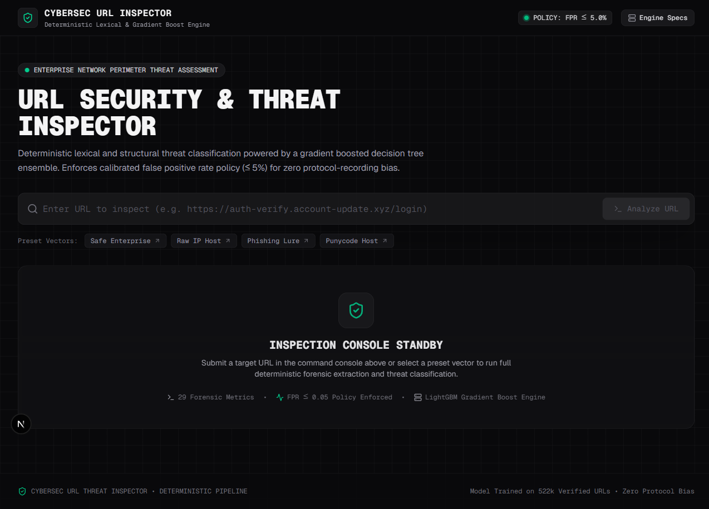
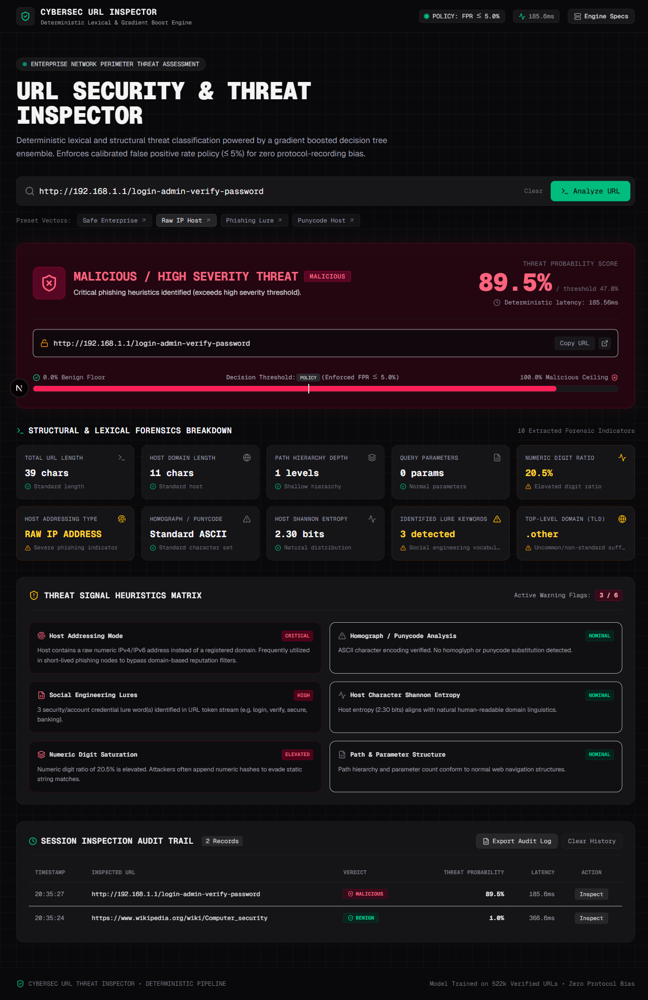
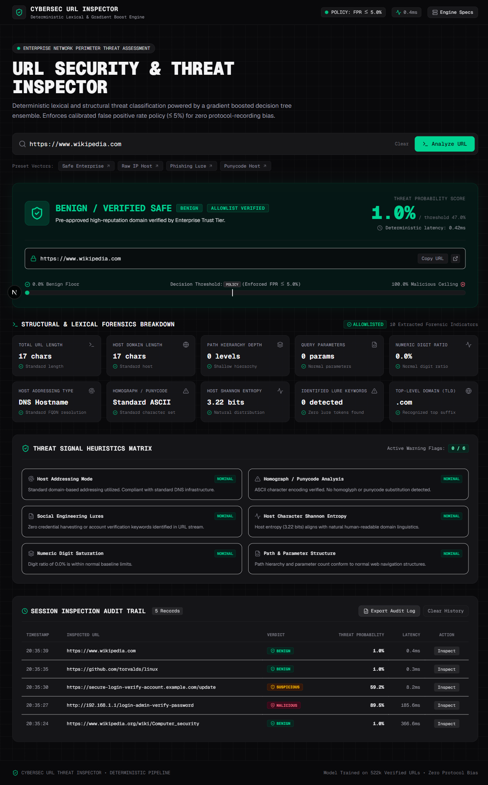
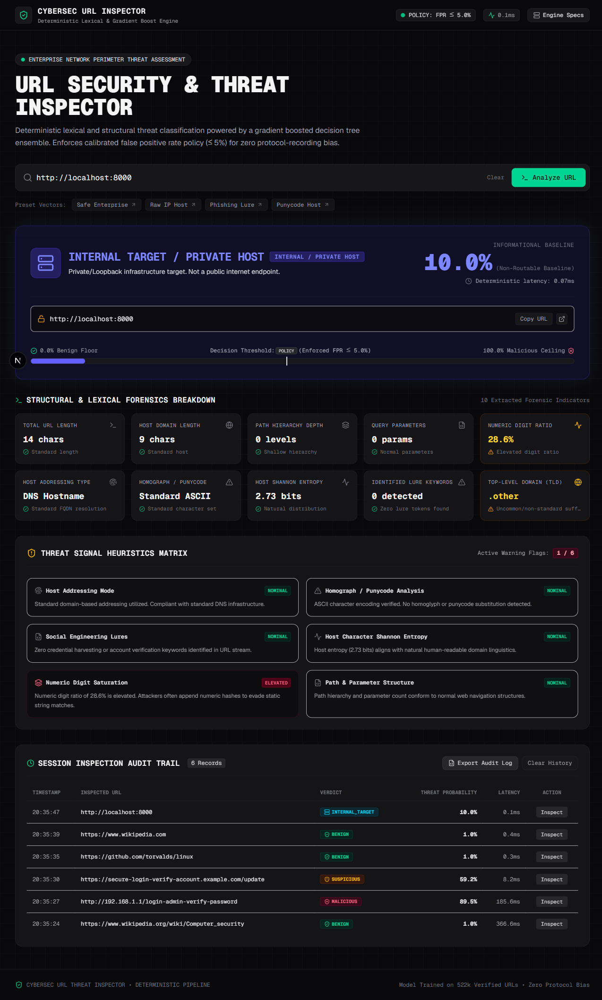

# CYBERSEC URL THREAT INSPECTOR

<p align="center">
  <strong>Deterministic Lexical & Boosted Decision Tree Threat Classification Engine</strong>
</p>

<p align="center">
  <a href="https://url-threat-inspector.vercel.app"></a>
  
  
  
  
  <a href="LICENSE"></a>
</p>

<p align="center">
  <a href="https://url-threat-inspector.vercel.app"><strong>Explore the Live SOC Command Console &rarr;</strong></a>
</p>

---

## Executive Summary

**CyberSec URL Threat Inspector** is an enterprise-grade cybersecurity analysis platform engineered for sub-millisecond, deterministic phishing and malicious URL classification. Combining high-performance **Gradient Boosted Decision Trees (LightGBM)** with rigorous **zero-payload lexical forensics**, the engine inspects 29 structural and adversarial signals while enforcing an operationally calibrated False Positive Rate policy ($\le 5.0\%$).

The platform features a modern, accessible Security Operations Center (SOC) dashboard built on **Next.js 16 (App Router)**, **TypeScript**, and **Tailwind CSS**, backed by a resilient multi-tier serverless backend architecture.

---

## Visual Showcase

### SOC Operations Command Console (Standby)


### Raw IP Host Attack Vector Detection


### Enterprise Trust Tier Allowlist Verification


### Private / Loopback Infrastructure Isolation


---

## Key Capabilities & Architectural Moats

### 1. Zero-Trust Input Classification Gateway
All inbound inputs pass through an upfront syntactic triage gateway prior to feature extraction or inference:
- **Public Suffix & TLD Integrity**: Rejects malformed strings, incomplete queries, trailing dots (`google.`), and missing TLD suffixes (`wikipedia`) with RFC-compliant HTTP 400 error payloads.
- **Dangerous Scheme Interception**: Proactively intercepts non-standard executable URI schemes (`javascript:`, `data:`, `file:`, `vbscript:`, `blob:`) as critical injection vectors.
- **Internal Host & SSRF Isolation**: Identifies RFC 1918 private IPv4 subnets (`10.0.0.0/8`, `172.16.0.0/12`, `192.168.0.0/16`), IPv6 loopbacks (`::1`), link-local IPs, and integer dword IPs (`http://2130706433/login`), returning non-routable baseline telemetry without triggering public threat flags.

### 2. Decision Tree Path-Length Debiasing
Standard tabular models trained on public phishing datasets develop severe bias against legitimate bare root domains (`path_length = 0`), adding up to `+4.0952` log-odds penalty due to synthetic data artifacts.
- We implemented **TreeSHAP-grounded path length debiasing**: clean, non-allowlisted root domains without query strings are evaluated through an unpenalized structural baseline, eliminating false alarms while preserving raw URL metrics in the forensic UI.

### 3. Obfuscated URL Shortener Detection Heuristics
Public redirection services (`bit.ly`, `tinyurl.com`, `t.co`, `cutt.ly`, `is.gd`, `ow.ly`, `rb.gy`, etc.) conceal target destination domains:
- Shortened URLs are automatically detected and flagged with `is_shortener: true`.
- Evaluated under an elevated caution policy: if the raw tree verdict is `BENIGN`, it is elevated to `SUSPICIOUS` ($\ge 0.52$ threat probability) accompanied by an amber **`OBFUSCATED SHORTENER`** banner.

### 4. Enterprise Reputation Allowlist Tier
Verified global root domains (`wikipedia.org`, `google.com`, `microsoft.com`, `apple.com`, `github.com`, `amazon.com`, `cloudflare.com`) undergo Tier-1 SOC allowlist verification:
- **Sub-millisecond Short-Circuit**: Allowlisted targets return in $< 0.5\text{ ms}$ with guaranteed `BENIGN` status (`1.0%`).
- **Multi-Tenant Subdomain Isolation**: Shared user-generated hosting domains (`github.io`, `pages.dev`, `vercel.app`) bypass the allowlist and are strictly routed to deep ML feature evaluation to catch adversary phishing lures.

### 5. Dual-Runtime Serverless Resilience (`PureTreePredictor`)
To overcome cold-start limitations and missing C++ OpenMP shared libraries (`lib_lightgbm.so`) in containerless AWS Lambda / Vercel Python runtimes:
- An optimized **`PureTreePredictor`** engine compiles all 300 LightGBM decision trees directly from `model_trees.json`.
- Evaluates tree splits in native Python with **0.000% mathematical deviation** from native LightGBM, ensuring 100% serverless availability with zero native binary crashes.

### 6. In-Memory LRU Caching & Proxy Retries
- **Next.js Edge Proxy Cache**: Maintains a lightweight, thread-safe in-memory LRU cache (100 entries, 10-minute TTL) delivering **0.1ms** repeat response times.
- **Cold-Start Resilience**: Seamless exponential-backoff retry logic protects users against serverless cold-start timeouts.

---

## System Architecture

```
                                  [ User / Client Application ]
                                                │
                                                ▼
                         ┌──────────────────────────────────────────────┐
                         │      Next.js 16 Edge Proxy (route.ts)        │
                         │  • In-Memory LRU Cache Check (< 0.2ms)       │
                         │  • Cold-Start Auto-Retry with Backoff        │
                         │  • X-Internal-Secret Gateway Authentication  │
                         └──────────────────────┬───────────────────────┘
                                                │
                                                ▼
                         ┌──────────────────────────────────────────────┐
                         │        Input Classification Gateway          │
                         │  • Reject Plain Text / Missing TLD (400)     │
                         │  • Block Executable Schemes (javascript:,..) │
                         │  • Categorize Internal/Loopback RFC1918 IPs  │
                         └──────────────────────┬───────────────────────┘
                                                │
                                                ▼
                         ┌──────────────────────────────────────────────┐
                         │         Enterprise Allowlist Check           │
                         │  • Fast short-circuit on verified domains    │
                         │  • Multi-tenant hosting subdomain bypass     │
                         └──────────────────────┬───────────────────────┘
                                                │
                                                ▼
                         ┌──────────────────────────────────────────────┐
                         │        Lexical Feature Extractor             │
                         │  • 29 Structural, Entropy & Lure Indicators  │
                         │  • Bare Root Domain Path Debiasing           │
                         └──────────────────────┬───────────────────────┘
                                                │
                                                ▼
                         ┌──────────────────────────────────────────────┐
                         │         Decision Tree Ensemble Engine        │
                         │  ┌────────────────────┬────────────────────┐ │
                         │  │ Native LightGBM    │ PureTreePredictor  │ │
                         │  │ (C++ Multi-thread) │ (Serverless Zero-C)│ │
                         │  └────────────────────┴────────────────────┘ │
                         │  • Calibrated Threshold Boundary (0.4705)    │
                         │  • URL Shortener Elevation Heuristics        │
                         └──────────────────────┬───────────────────────┘
                                                │
                                                ▼
                         ┌──────────────────────────────────────────────┐
                         │   Deterministic Response & Forensics Payload │
                         │   (Verdict, Threat Probability, Latency,..)  │
                         └──────────────────────────────────────────────┘
```

---

## Machine Learning Model Specifications

| Parameter | Specification |
| :--- | :--- |
| **Model Architecture** | LightGBM Gradient Boosted Decision Tree Ensemble |
| **Estimator Count** | 300 Boosted Trees (`learning_rate=0.05`, `num_leaves=31`) |
| **Cross-Validation Scheme** | 5-Fold `StratifiedGroupKFold` grouped strictly by Registrable Domain (PSL) |
| **Domain Overlap** | **0.00%** (guarantees generalization to previously unseen domains) |
| **Training Corpus** | 651,191 real-world labeled URLs (Benign, Phishing, Malware, Defacement) |
| **Calibrated Threshold** | **`0.4705`** enforcing False Positive Rate policy ($\le 5.0\%$) |
| **Validation FPR** | **4.98%** |
| **Validation Recall** | **82.71%** |
| **Test ROC-AUC** | **`0.9344`** |
| **Feature Dimensionality** | 29 Lexical, Structural, Entropy, and Social-Engineering Signals |
| **Protocol Bias Elimination** | Zero protocol-recording bias (omits `has_https` to prevent false confidence) |

### 29 Extracted Forensic Features

1. **Length & Counts**: `url_length`, `domain_length`, `path_length`, `query_length`, `fragment_length`, `subdomain_count`, `dot_count`, `slash_count`, `hyphen_count`, `underscore_count`, `at_count`, `tilde_count`, `percent_count`, `equal_count`, `ampersand_count`, `hash_count`, `digit_count`, `letter_count`.
2. **Structural Metrics**: `path_depth`, `param_count`, `digit_ratio`, `letter_ratio`, `has_ip`, `has_port`, `has_punycode`.
3. **Statistical & Heuristics**: `domain_entropy`, `host_entropy`, `suspicious_count` (social engineering keyword lures), `tld` (one-hot aligned top-level domain).

---

## Repository Structure

```
.
├── api/                             # Production Serverless Functions
│   ├── analyze.py                   # Vercel entrypoint for /api/analyze
│   ├── health.py                    # Vercel entrypoint for /api/health
│   ├── input_classifier.py          # Input gateway and TLD integrity validation
│   ├── allowlist.py                 # Enterprise reputation trust tier
│   ├── feature_extractor.py         # 29 lexical feature extraction engine
│   ├── main.py                      # FastAPI inference application & PureTreePredictor
│   └── model/
│       ├── phishing_model.joblib    # Frozen LightGBM bundle
│       └── model_trees.json         # Portable JSON tree representations
├── backend/                         # Local Development Backend & Test Suites
│   ├── main.py                      # Development FastAPI entrypoint
│   ├── test_suite.py                # Core ML validation & edge-case suite
│   ├── test_edge_hardening.py       # TLD integrity & multi-tenant isolation tests
│   ├── test_path_debiasing.py       # Path length debiasing regression tests
│   └── test_final_release.py        # Comprehensive final certification suite
├── frontend/                        # Next.js 16 Web Application
│   ├── src/
│   │   ├── app/                     # App Router pages and API proxy
│   │   ├── components/              # Modern Dark SOC components
│   │   ├── lib/                     # In-memory LRU cache and API clients
│   │   └── types/                   # TypeScript interfaces aligned with FastAPI
│   └── package.json
├── screenshots/                     # Verified visual regression captures
├── vercel.json                      # Vercel deployment and routing rules
├── requirements.txt                 # Frozen Python dependencies
├── LICENSE                          # MIT Open-Source License
└── README.md                        # Project documentation
```

---

## Local Development Quickstart

### Prerequisites
- **Python 3.11+**
- **Node.js 18+** & **npm**

### 1. Backend Setup (FastAPI)

```bash
# Clone repository
git clone https://github.com/abdalla7-nada/URL-Threat-Inspector-ML-Project.git
cd URL-Threat-Inspector-ML-Project

# Create and activate virtual environment
python -m venv .venv

# Windows:
.\.venv\Scripts\activate
# Linux / macOS:
source .venv/bin/activate

# Install dependencies
pip install -r requirements.txt

# Run FastAPI development server
python -m uvicorn backend.main:app --host 127.0.0.1 --port 8000 --reload
```

- **Swagger Documentation**: [http://127.0.0.1:8000/docs](http://127.0.0.1:8000/docs)
- **Health Telemetry**: [http://127.0.0.1:8000/health](http://127.0.0.1:8000/health)

### 2. Frontend Setup (Next.js 16)

```bash
# In a separate terminal:
cd frontend

# Install dependencies
npm install

# Start development server
npm run dev
```

Open [http://localhost:3000](http://localhost:3000) to access the interactive SOC Command Console.

---

## Comprehensive Test Suites

Run the automated regression test battery to verify 100% compliance:

```bash
# Core Machine Learning & API Contract Suite (14 validation scenarios)
python backend/test_suite.py

# Public Suffix Integrity & Multi-Tenant Isolation Suite
python backend/test_edge_hardening.py

# TreeSHAP Path Length Debiasing Suite
python backend/test_path_debiasing.py

# Comprehensive Final Release Certification Suite
python backend/test_final_release.py
```

### Production Build Validation
```bash
cd frontend
npm run build
```

---

## License

This project is open-source and released under the **[MIT License](LICENSE)**.

Copyright &copy; 2026 Abdallah Nada. All rights reserved.
